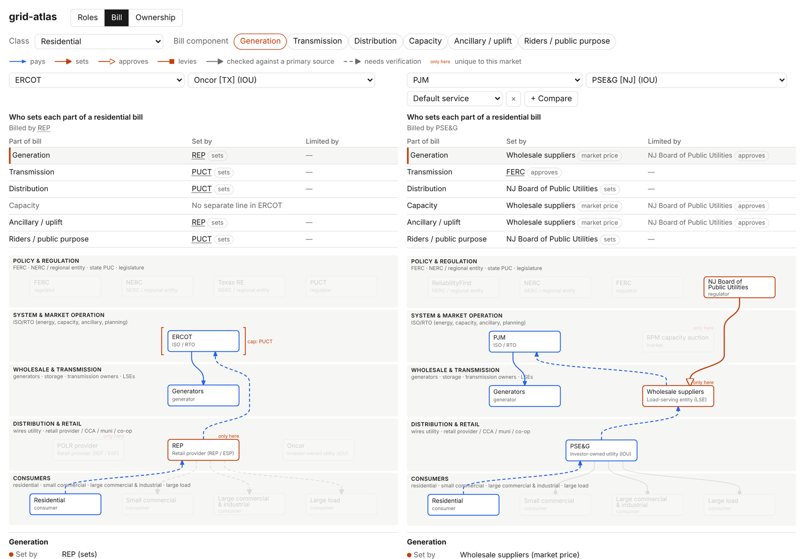

# grid-atlas

Live: https://hammerly-energy.github.io/grid-atlas/

An interactive diagram of the institutions in a US electricity market: regulators, the grid operator, generators, utilities and customers. Two markets can be shown side by side.

Markets: ERCOT (most of Texas), PJM (all or part of 13 Mid-Atlantic and Midwest states and Washington, DC) and CAISO (most of California). Great Britain is in progress.



## Questions it answers

For a given market, utility and customer type:

1. Who sets each part of the bill (generation, transmission, distribution, capacity, grid services, other charges), and who approves or caps it?
2. Who regulates what?
3. Who owns the power plants, transmission lines and local wires, and who only operates them?

## Coverage

| Market | Customer setups | Utilities | Relationships | Confirmed against a primary source |
|---|---|---|---|---|
| ERCOT | 3 | 5 | 125 | 35 |
| PJM | 7 | 6 | 266 | 176 |
| CAISO | 5 | 7 | 138 | 44 |
| Great Britain (in progress) | 1 | 1 | 23 | 16 |

A customer setup is a distinct arrangement within a market, for example a customer of a city-owned utility versus a customer who picks a retail supplier.

Each relationship cites a source. Solid lines have been checked against a primary source (statute, regulation, tariff, regulatory order or the body's own publication). Dashed lines have not.

## Tests

951 automated tests check the data format, references between records, specific market facts (for example, that ERCOT has no capacity market) and the rendered page. Three Great Britain tests are marked as expected failures until that data is entered.

## Run locally

```
python3 -m pip install -r requirements.txt
python3 scripts/build.py      # YAML -> web/data.json + web/data.js
python3 -m pytest -q -rx
open web/index.html
```

Data is in `data/countries/<country>/`, checked against `data/schema.json`. Research and sources are in `docs/research/`.

## Next

- Great Britain: remaining customer setups and the 14 regional distribution networks.
- MISO, SPP, NYISO and ISO-NE.
